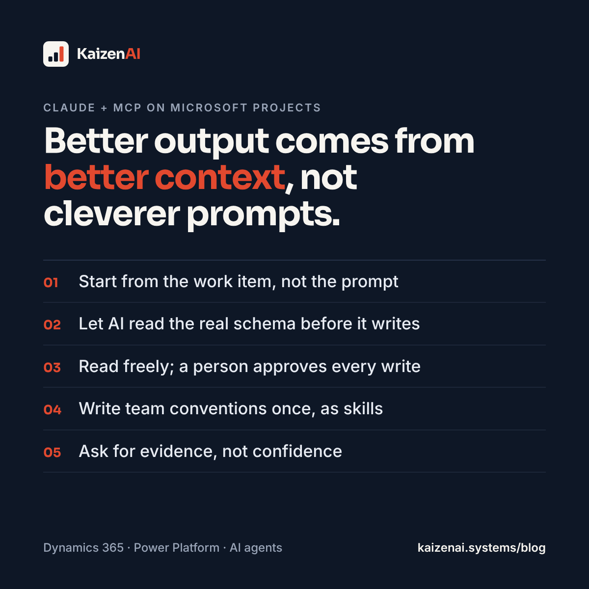

Most people use an AI assistant like a clever search box: copy a snippet in, copy an answer out. That works for small questions. It breaks down on real delivery work, where the context lives in a dozen systems: the ticket, the Dataverse schema, the solution in source control, the customer's mail thread, the vendor documentation.

The **Model Context Protocol (MCP)** fixes the plumbing. It is an open standard, introduced by Anthropic, that lets an AI client such as Claude talk to external systems through small "servers" that expose tools and data. Instead of pasting a table definition into the chat, Claude reads it from Dataverse. Instead of summarising a ticket from memory, it opens the ticket.

This post covers how we set that up and, more importantly, the working rules that turn it from a demo into something that raises the quality of our work.

## What we connect

A typical Microsoft delivery setup for us looks like this:

| MCP server | What Claude can do with it |
|---|---|
| Jira / Confluence (Atlassian) | Read the work item, acceptance criteria and linked pages; draft comments |
| Dataverse | Inspect table schemas, query records, check configuration data |
| Microsoft 365 | Find the mail thread, the meeting, the SharePoint file |
| Microsoft Learn | Check current product documentation instead of relying on training data |
| Source control (GitHub / Azure DevOps) | Read the solution, the pipeline, the commit history |

Each server is scoped to the permissions of the person who connected it. Claude cannot see anything that person could not see. That matters, and we come back to it below.

## Rule 1: start from the work item, not the prompt

Every session starts with the ticket. "Read PROJ-142, then the linked Confluence page, then tell me what is unclear." This does three things:

- Claude works against the real acceptance criteria, not my paraphrase of them.
- Gaps in the ticket surface before any code is written.
- The session is traceable: anyone can see which item the work belonged to.

If no ticket fits the work, that is worth knowing too. Untracked work is how scope creeps.

## Rule 2: let it read before it writes

The biggest quality gain comes from reading, not generating. Before Claude writes a plugin, a flow expression or a FetchXML query, we have it inspect the actual schema through the Dataverse server: logical names, data types, relationships, option set values.

The classic AI failure in Dynamics 365 work is a confident answer built on a field that does not exist, or on the display name instead of the logical name. Reading the schema first removes most of those errors at source.

The same applies to documentation. Product behaviour changes faster than any model's training data, so for anything version-sensitive we ask Claude to check Microsoft Learn first and cite what it found.

## Rule 3: separate reading from writing

We treat MCP tools in two classes:

- **Read** (search, get, query): Claude may use these freely.
- **Write** (create record, comment, send mail, transition ticket): Claude drafts, a person approves.

This is the same human-in-the-loop principle we apply to the agents we build for clients. It costs a few seconds per action and prevents the expensive mistakes: a comment on the wrong ticket, a record created in production instead of dev, a mail sent before it was reviewed.

Practical tip: keep separate connections for dev, test and production environments, name them clearly, and connect production read-only unless you have a specific reason not to.

## Rule 4: write instructions once, as skills

Every team has rules that never make it into a prompt: naming conventions, the publisher prefix, how Jira comments should look, which language documentation is written in, what must never be stored in a ticket. Repeating them in every chat is error-prone.

Claude supports reusable instruction packages ("skills") and organisation-level instructions. We encode the rules once:

- Solution and publisher conventions
- Documentation standards (where it lives, what language, which template)
- Linking rules (every artefact links back to its work item)
- Confidentiality rules (what may never go into a widely readable system)

The result is consistency. A junior consultant and a senior one get the same guardrails.

## Rule 5: ask for evidence, not confidence

Good prompts ask Claude to show its working against real sources:

- "Which fields did you check in the schema?"
- "Link the Learn article that says this is supported."
- "If you could not verify it, say so."

An answer that says "I could not confirm this in the documentation" is more useful than a fluent guess. We would rather get an honest gap than a polished error.

## Rule 6: keep the context lean

MCP makes it easy to pull in too much: whole mailboxes, entire Confluence spaces, every record in a table. That slows responses, costs tokens and dilutes attention.

- Query narrowly: filter by key, date or owner rather than listing everything.
- Read the one page that matters, not the whole space.
- Start a fresh session when the task changes.

## Rule 7: close the loop

When the work is done, the same connections let Claude finish the paperwork that usually gets skipped: a short Jira comment linking the commit, an updated Confluence page rather than a new duplicate, an admin note in the knowledge base. Documentation that is cheap to write actually gets written.

## What it changes in practice

On our own Dataverse and Power Platform work, the gains are not about writing code faster. They are about:

- **Fewer wrong assumptions**, because schemas and docs are read, not guessed.
- **Better tickets**, because gaps are found before build starts.
- **Consistent output**, because team rules live in skills, not in people's heads.
- **Complete documentation**, because closing the loop takes minutes, not an afternoon.

## Where to be careful

- **Permissions are inherited.** Claude sees what you see. Fix oversharing first; the same lesson applies as for [Copilot readiness](/blog/copilot-readiness-permissions-first/).
- **Third-party servers are code.** Only connect MCP servers from vendors you trust, and review what each tool can do.
- **Customer data stays where it belongs.** Do not move content from a restricted system into a place with a wider audience.

## Start small

You do not need everything on day one. Connect your ticketing system and your documentation source, adopt the read-then-write rule, and write down three team conventions as a skill. Improve from there, a little every week.

If you want help setting this up for a Microsoft and Dataverse team, [get in touch](/contact/).
